<div align="center">


### Nuestro espacio, todos nuestros planes.

**El dashboard privado de Álvaro y Angie:** trabajo y vida en pareja en un mismo sitio,<br/>con un agente de IA que actúa, calendario de Google fusionado, viajes vivos y reuniones transcritas.

<br/>


<br/>

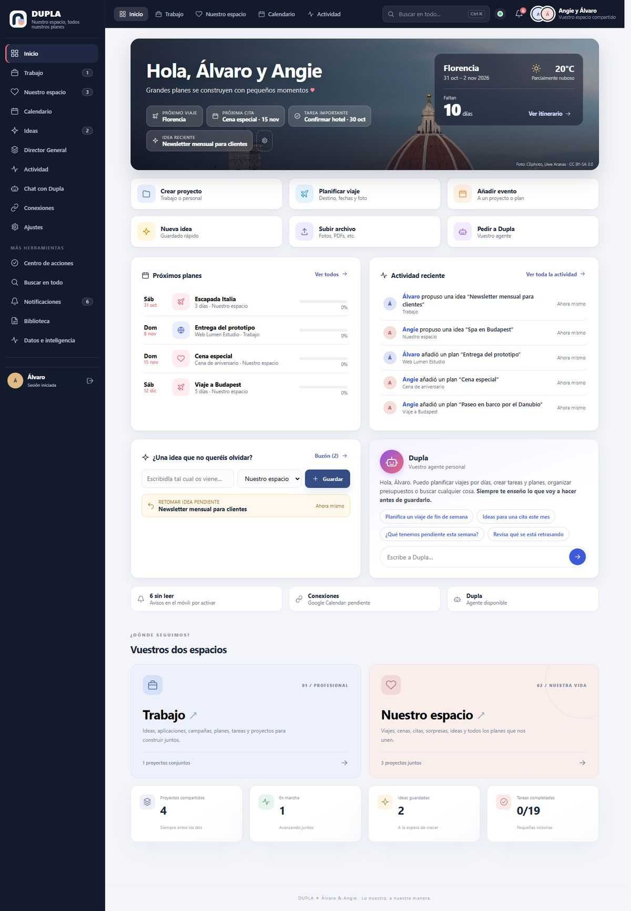

</div>

---

## Índice

- [Qué es DUPLA](#qué-es-dupla)
- [Lo que hace](#lo-que-hace)
- [Dupla, el agente](#dupla-el-agente)
- [Arquitectura](#arquitectura)
- [Seguridad y privacidad](#seguridad-y-privacidad)
- [Estructura del proyecto](#estructura-del-proyecto)
- [Desarrollo, pruebas y publicación](#desarrollo-pruebas-y-publicación)
- [Configuración](#configuración)
- [Estado y próximos pasos](#estado-y-próximos-pasos)

---

## Qué es DUPLA

DUPLA es una aplicación web **privada para dos personas**. Tiene dos espacios separados, **Trabajo** y **Nuestro espacio**, y alrededor de ellos todo lo que una pareja necesita para organizarse: proyectos, viajes con su día a día, calendario compartido, presupuestos, ideas, recuerdos, tareas, reuniones con transcripción y un agente de IA que propone y ejecuta cambios **siempre con vuestra confirmación**.

Corre entera en el borde de Cloudflare: un Worker y un Durable Object con SQLite, sin servidores que mantener. Funciona igual en el ordenador y en el iPhone, también instalada como app (PWA) con avisos push.

---

## Lo que hace

<table>
<tr>
<td width="50%" valign="top">

### 🏠 Inicio
Cabecera con la foto del próximo destino, el tiempo que hace allí y la cuenta atrás. Accesos rápidos, próximos planes con progreso (incluidos los eventos de Google), actividad reciente, idea rápida y la tarjeta de Dupla. El resumen de arriba se configura y es **compartido** entre los dos.

</td>
<td width="50%" valign="top">

### 📅 Calendario fusionado
Vistas de mes, semana y agenda. Junta en una sola vista los eventos de DUPLA, el calendario compartido **«DUPLA · Nuestro calendario»** y los **calendarios personales de cada uno** (cada persona en su color). Marca los **choques de horario** en rojo, crea eventos con **Google Meet** y vincula cada evento a un proyecto.

</td>
</tr>
<tr>
<td valign="top">

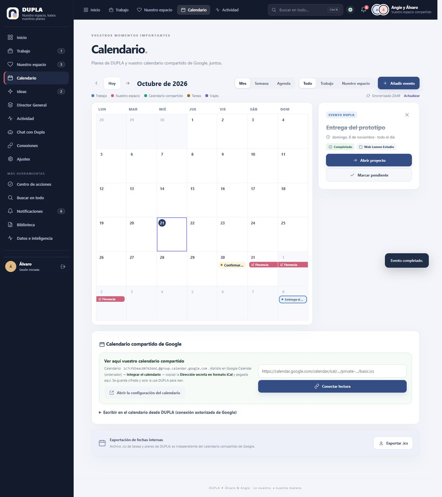

</td>
<td valign="top">

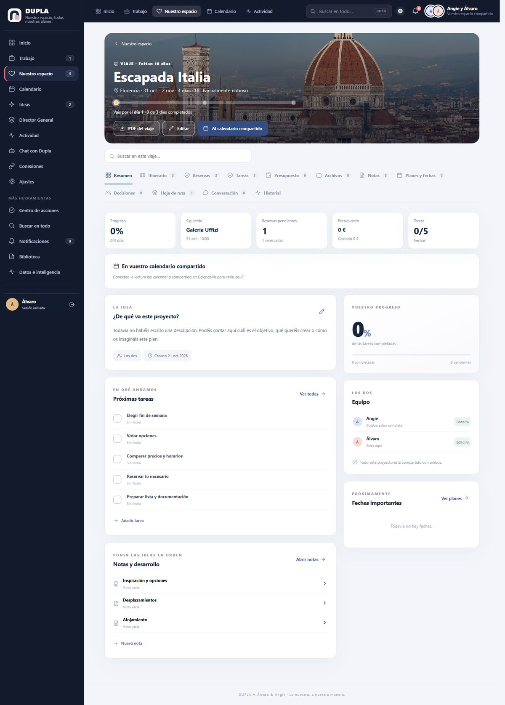

</td>
</tr>
<tr>
<td valign="top">

### ✈️ Viajes vivos
Cabecera con foto del destino (Wikimedia) y barra de progreso: *«vais por el día 2»*. Itinerario por días con casillas, actividades hechas, canceladas o reagendadas, reservas utilizadas y eventos del calendario dentro del viaje. Avisos **«Antes de reservar»**: festivos, puentes, fiestas y ferias que encarecen las fechas.

</td>
<td valign="top">

### 💶 Presupuestos con memoria
Historial por destino: cuánto costó cada viaje, alojamiento por noche, comidas y salidas por día (en rango), billetes y **con cuántos días de antelación reservasteis**. Calcula el próximo viaje con un rango estimado y avisos: festivos nacionales y regionales, Navidad, verano, eventos recurrentes según la IA y **vuestros propios avisos por destino y mes**.

</td>
</tr>
<tr>
<td valign="top">

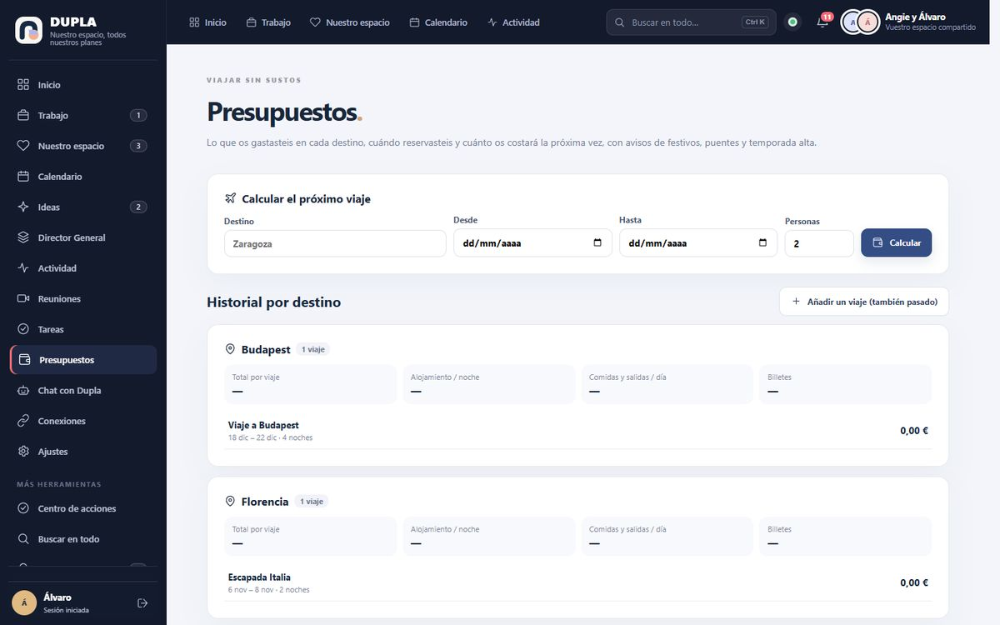

</td>
<td valign="top">

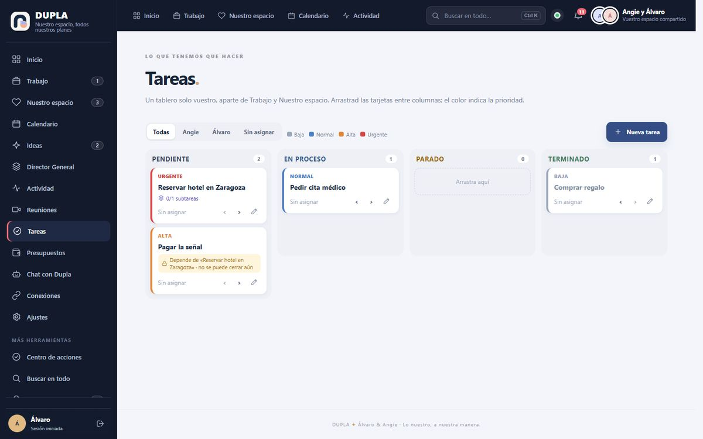

</td>
</tr>
<tr>
<td valign="top">

### ✅ Tablero de tareas
Un tablero tipo Trello solo vuestro, aparte de los dos espacios: **Pendiente · En proceso · Parado · Terminado**. Se arrastran las tarjetas, el color marca la prioridad y cada tarea tiene responsable y fecha. Con **tarea padre**: la hija no se puede cerrar hasta que la padre esté terminada.

</td>
<td valign="top">

### 🎥 Reuniones transcritas
Videollamada propia (WebRTC directo, señalización por la API) o **Google Meet**. Cada persona graba **su propio micrófono** y Whisper lo transcribe por tramos: transcripción **fiel**, con quién dijo qué y cuándo, y cada frase con su grabación. Al terminar se generan solos el **resumen, las tareas y las decisiones**, siempre aparte de la transcripción.

</td>
</tr>
<tr>
<td valign="top">

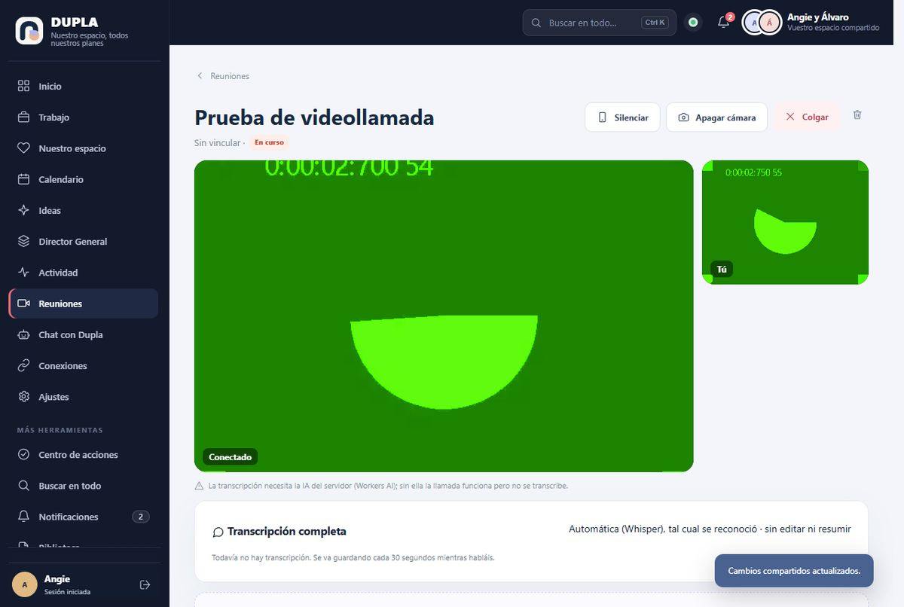

</td>
<td valign="top">

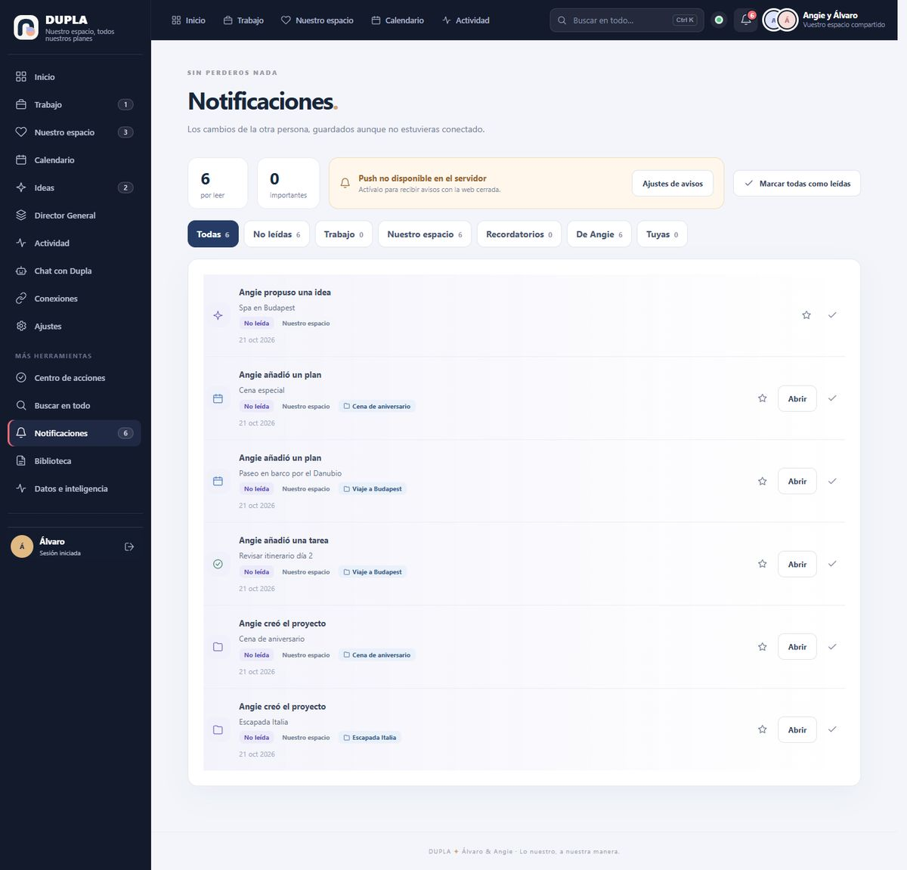

</td>
</tr>
<tr>
<td valign="top">

### 🔔 Avisos de verdad
Notificaciones del sistema en el **PC y en el iPhone**, aunque DUPLA esté cerrada. Push cifrado de extremo a extremo (RFC 8291), filtros, avisos marcados como importantes y estado de entrega por dispositivo. **Resumen de cada mañana** a las 8:00, también como evento en Google Calendar para que el móvil avise siempre.

</td>
<td valign="top">

### 💡 Ideas, actividad y más
Captura rápida de ideas que no se pierden (borrador guardado en el dispositivo), estados, «para retomar» y conversión en proyecto, plan, viaje o deseo. Cronología de actividad por día con filtros. Buscador agrupado con **búsqueda semántica**. Director General con propuestas reales. PDFs de itinerario, dossier y presupuesto para clientes.

</td>
</tr>
</table>

### 💞 Nuestro espacio
Planes por tipo (viajes, citas, celebraciones, planes de finde), **recuerdos con fotos**, metas con progreso, deseos, regalos, organización de la casa, **presupuesto común** separado del de Trabajo y un planificador de pareja con propuestas guiadas.

<p align="center">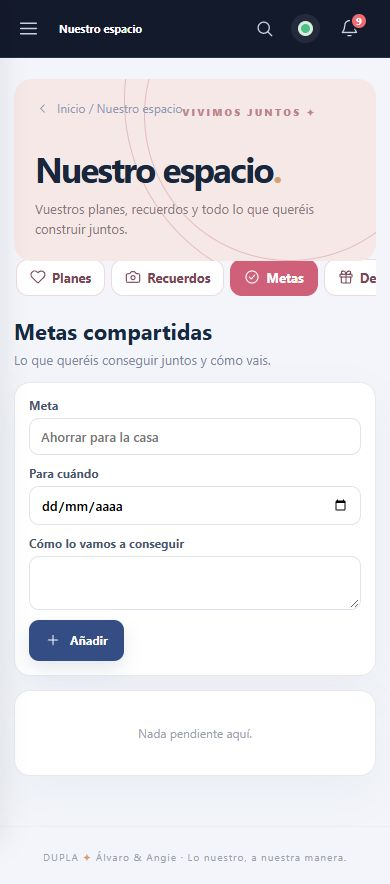 &nbsp; 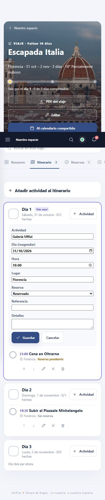</p>

---

## Dupla, el agente

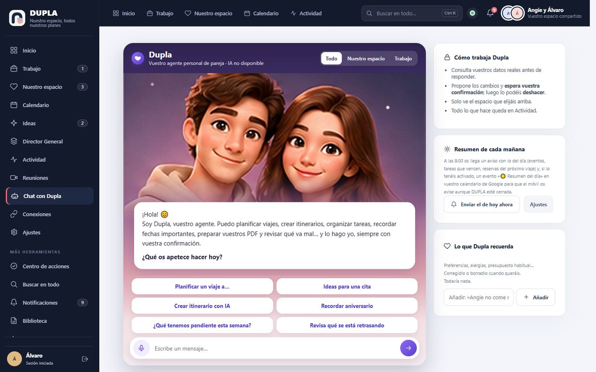

Dupla **no es un chatbot**: es un agente que consulta vuestros datos reales con herramientas y **propone cambios concretos** que solo se aplican cuando pulsáis «Hacer».

- Crea proyectos, viajes, tareas, planes, gastos e ideas, y **eventos en Google Calendar**, con Meet si hace falta.
- Revisa con el **Director General** qué va mal o se retrasa.
- Consulta los **avisos del destino** antes de planificar un viaje.
- Prepara **PDFs** (itinerario, dossier, presupuesto para clientes).
- **Deshace** lo último que confirmasteis.
- Habla **por voz**: graba, transcribe con Whisper y envía.
- Tiene **memoria editable**: alergias, gustos, presupuesto habitual…
- Respeta el **ámbito** que elijáis: Todo, Trabajo o Nuestro espacio.

Modelo: `@cf/openai/gpt-oss-120b` en Workers AI, gratuito y sin claves externas.

<br clear="right"/>

---

## Arquitectura

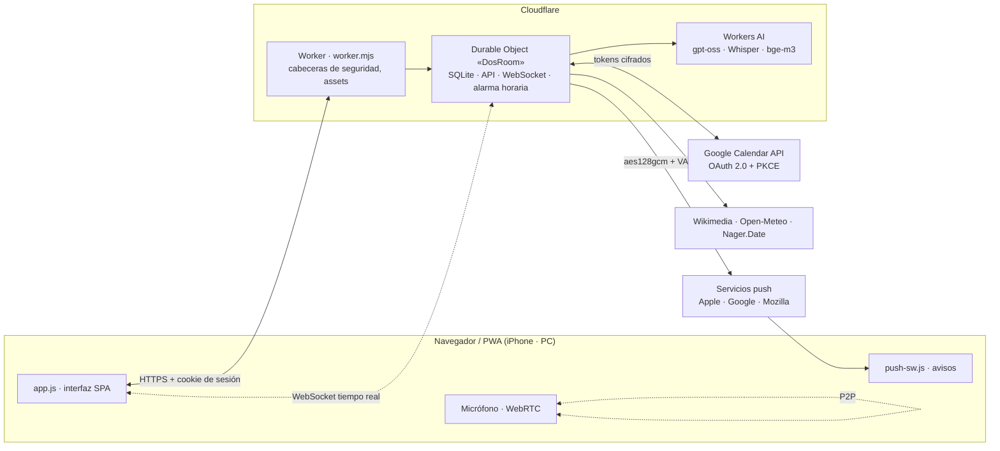

- **Un único Durable Object** guarda todo en SQLite. Las migraciones son aditivas: nunca se borra nada.
- **Alarma horaria**: recordatorios, Director General, resumen de la mañana, avisos inteligentes, copias de seguridad y cola de push.
- **Tiempo real**: lo que edita uno aparece al momento en la pantalla del otro.

---

## Seguridad y privacidad

| | |
|---|---|
| 🔒 **Solo dos cuentas** | Contraseñas con hash, sesiones con cookie `HttpOnly`/`Secure`, sin registro público. |
| 🧱 **Cabeceras estrictas** | CSP `self`, `frame-ancestors 'none'`, `Permissions-Policy` (cámara y micro solo para DUPLA), HSTS. |
| 🔑 **Secretos fuera del código** | Claves de Google, VAPID y cifrado como *secrets* de Cloudflare; copia local cifrada con DPAPI. |
| 🗝️ **Tokens cifrados** | Tokens de Google con AES-GCM en el servidor; nunca llegan al navegador. |
| 📅 **Permisos mínimos** | Solo Google Calendar (eventos y lista de calendarios). Nada de correo, contactos ni Drive. |
| 📣 **Push cifrado** | Contenido cifrado de extremo a extremo: Apple y Google solo ven bytes opacos. |
| 🧾 **Todo queda registrado** | Cada cambio aparece en Actividad; el agente nunca guarda sin confirmación. |

Políticas públicas: [privacidad](edge/public/privacidad.html) · [condiciones](edge/public/condiciones.html)

---

## Estructura del proyecto

```
edge/
  worker.mjs            Entrada del Worker + Durable Object «DosRoom» (no renombrar)
  api.mjs               API principal: proyectos, tareas, notificaciones, Google, copias…
  v6.mjs                Módulos v6: agente Dupla, calendario, viajes, reuniones, tablero,
                        presupuestos, Director, Nuestro espacio, búsqueda semántica
  db.mjs · schema.mjs   SQLite y migraciones aditivas
  google-calendar.mjs   OAuth 2.0 + PKCE, rutas permitidas de Calendar, cifrado de tokens
  web-push.mjs          Web Push con VAPID y cifrado aes128gcm
  public/               app.js · style.css · index.html · push-sw.js · vendor/jspdf
tests/                  158 pruebas (node:test) con IA, Google y red simulados
scripts/                publicar, deshacer, capturas en Chrome real, conexión con Google…
docs/capturas/          Capturas con datos de ejemplo
```

---

## Desarrollo, pruebas y publicación

```bash
npm install
npm run verificar                 # sintaxis + 158 pruebas
node scripts/captura.mjs --datos  # Chrome real con dos cuentas de prueba (390 / 768 / 1440 px)
node scripts/captura.mjs --datos --puerto 8790 --servir   # vista previa local navegable
node scripts/prueba-reunion.mjs   # dos Chrome se llaman por WebRTC y deben verse
```

**Publicar** (Windows, con la credencial cifrada creada una vez con `npm run credencial`):

```bash
npm run publicar:ensayo   # todo menos desplegar
npm run publicar          # pruebas → copia de los datos reales → commit + etiqueta → deploy → verificación en vivo
npm run deshacer          # vuelve a la versión anterior (los datos no se tocan)
```

> No se despliega nunca con `wrangler deploy` a mano: `npm run publicar` hace antes la copia de seguridad y después comprueba que el código en vivo es idéntico al local.

---

## Configuración

*Secrets* de Cloudflare (los valores nunca van al repositorio):

| Secreto | Para qué |
|---|---|
| `SETUP_TOKEN` | Creación inicial de las dos cuentas |
| `INTEGRATION_ENCRYPTION_KEY` | Cifrado de tokens de Google |
| `PUSH_VAPID_PRIVATE_JWK` · `PUSH_VAPID_PUBLIC_KEY` · `PUSH_VAPID_SUBJECT` | Avisos push |
| `GOOGLE_CLIENT_ID` · `GOOGLE_CLIENT_SECRET` | OAuth de Google Calendar |

Variables y *bindings* en `wrangler.jsonc`: `PUBLIC_ORIGIN`, `AI` (Workers AI), `DOS_ROOM` (Durable Object) y `ASSETS`.

Scripts de ayuda: `scripts/configurar-secretos.ps1` (VAPID y cifrado), `npm run google` (cliente OAuth) y `scripts/conectar-google.ps1` (conecta y verifica el calendario).

---

## Estado y próximos pasos

**Funcionando y comprobado en la web real:** las dos cuentas con edición compartida en tiempo real, calendario compartido de Google (leer, crear, editar, borrar), Google Meet, IA real (agente, voz, avisos de destino), resumen diario, PDFs, tablero, presupuestos y el resto de pantallas sin errores en ordenador y móvil.

**Pendiente de hacer por vosotros:**
- [ ] Conectar cada uno sus calendarios personales (Calendario → «Fusionar mis calendarios de Google»).
- [ ] Activar los avisos en cada dispositivo (iPhone instalado en la pantalla de inicio y PC).
- [ ] Primera reunión real con Meet y transcripción de los dos.

**Ideas por delante:** servidor TURN de Cloudflare para videollamadas en redes muy cerradas y fuentes de eventos (congresos, huelgas) cuando haya alguna gratuita y fiable.

---

<div align="center">

**DUPLA** ✦ Álvaro &amp; Angie · *Lo nuestro, a nuestra manera.*

<sub>Proyecto privado de uso personal. No se aceptan contribuciones externas.</sub>

</div>
